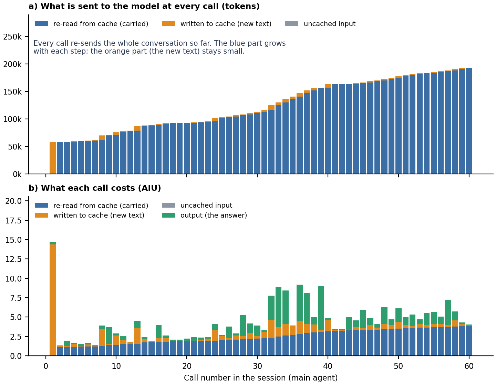
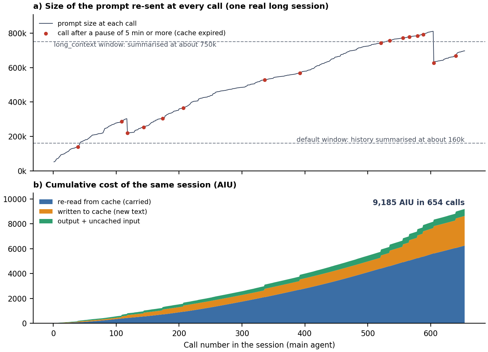
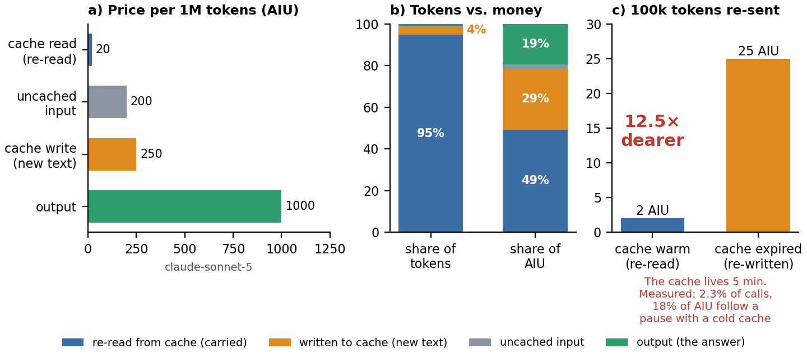
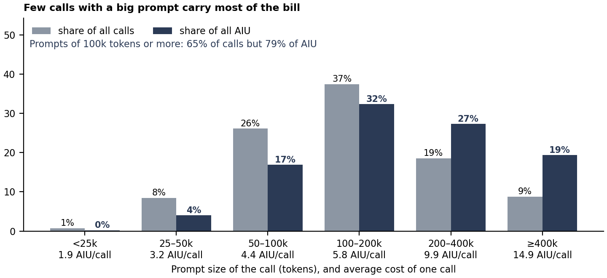

# Context carrying explained: why Copilot CLI bills for history

*Written 13 Oct 2026. Companion to the work-group synthesis (`workgroup-synthesis-2026-10-13.md`). Numbers come from the local usage log of one workstation: 21,712 model calls in 210 sessions, 24 Jul – 13 Oct 2026. Limits are in section 7, how to reproduce in section 8.*

## 1. In short

- **Context carrying is the whole conversation being sent to the model again at every step.** It is 78.5% of the bill: cache read 49.3% + cache write 29.2%. What the model writes is 19.4%; new input is 2.1%.
- **Cheap per token, huge in volume.** A cached token costs 10× less than a fresh one, yet cache reads are 95% of all tokens, so they are still 49% of the cost.
- **Later steps cost more than early ones.** The history keeps growing until it is summarised: a call costs 1.9 AIU on average with a prompt under 25k tokens and 14.9 AIU above 400k.
- **A pause of 5 minutes or more makes it worse.** The cache expires and the history is paid for again at 12.5× the re-read price: 2.3% of calls, 18% of the bill.
- **So the levers are:** keep the history short (default window, fresh sessions), keep it warm (no idle gaps) and start it lean (fewer tools and skills).

Unit: AIU is the CLI's billing unit (`total_nano_aiu / 1e9`; 1 AI credit = $0.01). Prices are for claude-sonnet-5 (62% of AIU).

## 2. What is carried, and why every call pays for it

The model keeps no memory between calls. Each step of an agent session (read a file, run a command, edit, answer) is one call, and every call re-sends:

- **a fixed start of ≈42k tokens** before your first message: system prompt ≈13k, 29 tool schemas ≈13k (≈450 tokens each), instructions, 44 skills ≈2.5k;
- **everything since:** your messages, the assistant's messages, tool arguments and tool results (file views, command output).

A 60-step task sends its beginning 60 times. The unchanged part is kept in a **prompt cache** and billed at a lower "cache read" price:

| Token type | AIU per 1M tokens | What it is |
|---|---:|---|
| Uncached input | 200 | new text that is not in the cache |
| Cache write | 250 | new text stored for the next calls: 25% dearer than plain input, repaid at the first re-read |
| Cache read | 20 | history re-sent from the cache: this is the carrying |
| Output | 1,000 | what the model writes |

A call costs its token counts times these prices:

```
AIU per call = (read × 20 + write × 250 + input × 200 + output × 1,000) / 1,000,000
```

<figure>

<figcaption><b>Figure 1.</b> The first 60 calls of one real session (claude-sonnet-5, main agent). (a) Tokens sent at each call: blue = history re-read from the cache, orange = new text written to the cache. (b) Cost of each call in AIU: the first call writes the 57.5k-token start (14.7 AIU); later calls re-read it (1 to 4 AIU) and the green answer part is added.</figcaption>
</figure>

**Reading Figure 1.** Call 1 costs 14.7 AIU because 57.5k new tokens (the start of this session; the plan's typical figure is ≈42k before the first message) are written to the cache. Call 2 costs 1.3 AIU: the same 57.5k are now re-read, about 11× cheaper. From then on each call adds a little new text (orange) and re-reads everything before it (blue), so the prompt grows from 57.9k tokens (call 2) to 192.9k (call 60) and the cost of a call from 1.3 to 4.0 AIU. Over these 60 calls carrying is 74% of the 264 AIU; the answers (green) are 26%.

## 3. The longer the session, the dearer each step

Figure 2 follows the biggest session in the log: 654 calls, one model, 9,185 AIU (6.3% of all AIU). Its prompt grows from 52.6k to a peak of 810.7k tokens.

<figure>

<figcaption><b>Figure 2.</b> The biggest session in the log. (a) Prompt size at each call; the dashed lines are the two points where the history is summarised; red dots are calls that found the cache expired after a pause of 5 minutes or more. (b) Cumulative cost: the curve bends upward because each call re-reads a bigger history.</figcaption>
</figure>

- **The cost curve bends upward (b).** Each call re-reads all the history before it: the first half of the calls cost 31% of the session's AIU, the last third 51%. The median call costs 4.3 AIU over the first 50 calls and 14.0 AIU over the last 50.
- **Big prompts dominate.** 434 calls had a prompt of 400k tokens or more; they carry 81% of the session's AIU.
- **Summarising is the built-in brake.** The dashed lines are the two points where the history is summarised ("compacted"): ≈160k with the default window, ≈750k with `long_context`. Its prompts go far above 160k, so it must have run on the large window, where the history keeps growing. Its only two drops (call 118: 303k → 220k; call 605: 811k → 626k) each remove about 25%. They may be summaries or manual trims; the trigger could not be verified (the first is well below 750k).
- **Pauses show up as red dots (a).** 16 calls found the cache expired after a pause of 5 minutes or more. They average 136 AIU each and carry 24% of the session's cost: see the next section.

## 4. Why cheap tokens still make up most of the bill

<figure>

<figcaption><b>Figure 3.</b> Why carrying dominates. (a) Price per 1M tokens. (b) Share of tokens vs share of AIU for each token type. (c) Cost of re-sending a 100k-token history: 2 AIU from a warm cache, 25 AIU after the cache has expired.</figcaption>
</figure>

- **Volume beats price (b).** Cache reads are 94.9% of all tokens and 49.3% of AIU. Cache writes are 4.0% of tokens but 29.2% of AIU (12.5× the read price). Output is 0.7% of tokens but 19.4% of AIU. Fresh input is 0.4% of tokens and 2.1% of AIU. Carrying (read + write) is 78.5%.
- **The cache is short-lived (c).** It lives about 5 minutes (300 s; it may differ per model). After a longer pause the next call finds nothing cached and writes the whole history again at 250 instead of reading it at 20: for 100k carried tokens, 25 AIU instead of 2.
- **Measured on whole calls:** prompts of 100–200k cost 5.1 AIU warm vs 40.0 AIU cold (7.9×, 176 cold calls); prompts of 400k or more cost 11.7 vs 143.6 AIU (12.3×, 46 cold calls). The ratio is lower on smaller prompts because output and new text cost the same either way.
- **Overall:** 493 cold calls are 2.3% of calls but 18.4% of AIU. Cache writes on cold calls alone are 17.4% of all AIU, i.e. 60% of all cache-write cost.
- **Who causes the pauses** (the plan's data cut, 8 Jun – 9 Oct): users resuming idle sessions, ≈12.4% of AIU (247 calls, ≈3 h idle on average, ≈231k tokens of context, ≈65 AIU for the first call vs ≈11 for a fresh session); agent-side waits, ≈7.3% (approvals, `ask_user`, `sleep`/`read_bash` polls, sub-agents).

## 5. A few big prompts carry most of the bill

<figure>

<figcaption><b>Figure 4.</b> Share of all calls (grey) vs share of all AIU (dark blue) by prompt size, with the average cost of one call. Big prompts are fewer but dearer.</figcaption>
</figure>

- Prompts of 100k tokens or more are 65% of calls but 79% of AIU. Those of 400k or more are 9% of calls and 19% of AIU, at 14.9 AIU per call against 1.9–4.4 for prompts under 100k.
- The mean prompt is 175k tokens, but the AIU-weighted mean is 250k: the money is spent in bigger contexts than the typical call suggests.
- About 24% of all AIU is spent on prompt tokens above 160k (≈18% above 200k). This is an upper bound on what a window that summarises at ≈160k can remove, because summarising costs a call and the summary is carried afterwards; the plan estimates 15–20%.
- Sessions are concentrated too (earlier cuts): 12 sessions = 50% of AIU in the plan, 31 sessions (15%) = 71% in the 10 Oct report.
- Sub-agents carry less: their mean prompt is 91k tokens vs 190k for the main agent. They are 15% of calls and 9.9% of AIU.

## 6. What reduces carrying

| Lever | How it reduces carrying | Fig. | Est. saving |
|---|---|:-:|---|
| Default context window (`contextTier: default`) | history is summarised at ≈160k instead of ≈750k: caps the blue area | 2, 4 | 15–20% |
| Fresh session + short hand-over note, instead of resuming a stale one (note not built yet) | no cold rebuild of a big history: ≈11 vs ≈65 AIU for the first call | 3c | up to 8–10% |
| Agent polls (`sleep`, `read_bash`) of 240 s or less | the cache is still warm at the next call | 2a | ≈1% |
| Batch independent tool calls | fewer calls, so fewer re-reads | 1 | 3–5% |
| Delegate noisy loops to a sub-agent | their output stays out of the main history | — | 1–2% |
| Targeted search (planned `code_search` tool) instead of whole-file views | less text enters the history | — | 1–3% |
| Fewer, terser tools and skills | the fixed start is ≈15% of spend; each tool adds ≈450 tokens to every call | 1 | not quantified |
| Soft cap `--max-ai-credits 1000`; `copilot-long` only when needed | a decision point for the few sessions that decide the bill | 4 | not quantified |

Estimates come from the plan (§10): they are upper bounds that overlap, so they cannot be added. Goal −50%, expected −30 to −40%. See the synthesis, sections 3 and 5, for status and what to do today.

## 7. Caveats

- One workstation and one user. This cut (24 Jul – 13 Oct) differs from the plan's (8 Jun – 9 Oct) and from the 10 Oct report's: carrying is 78.5% here, ≈83% in the plan and ≈80% in the report. Do not read this drift as an effect of the 9 Oct changes: only a few days of data follow them, and the first before/after comparison is due about 16 Oct.
- "Cold" means a call at least 300 s after the previous call of the same session and agent, with a cache read below 50% of its prompt. It is a heuristic.
- The "above 160k / 200k" shares apply the average prompt price per token: an approximation and an upper bound.
- Prices shown are claude-sonnet-5's; the token-type split uses each call's own prices.
- That the drops in Figure 2 are summaries is inferred from prompt size only.

## 8. Reproduce

```bash
cd ~/copilot
python3 docs/make_context_figures.py    # read-only on ~/.copilot/session-store.db; prints the numbers quoted here and rewrites docs/figures/ctx-*.png
```

It needs `matplotlib` and `numpy`, and reads `assistant_usage_events` (prices come from each row's `token_details_json`). The log keeps growing, so a re-run gives slightly different numbers; this document quotes one run (21,712 calls).

PDF export (from `~/copilot`; `-u docs/` lets WeasyPrint find the figures):

```bash
pandoc -f gfm -t html5 --wrap=none --template docs/plan-pdf.html \
  --metadata pagetitle="Context carrying explained: why Copilot CLI bills for history" \
  docs/context-carrying-explained.md | weasyprint -u docs/ - docs/context-carrying-explained.pdf
```

Sources: `PLAN.md` (§2 evidence, §10 savings), `docs/manager-report-2026-10-10.html`, and the local usage log via `docs/make_context_figures.py`.
